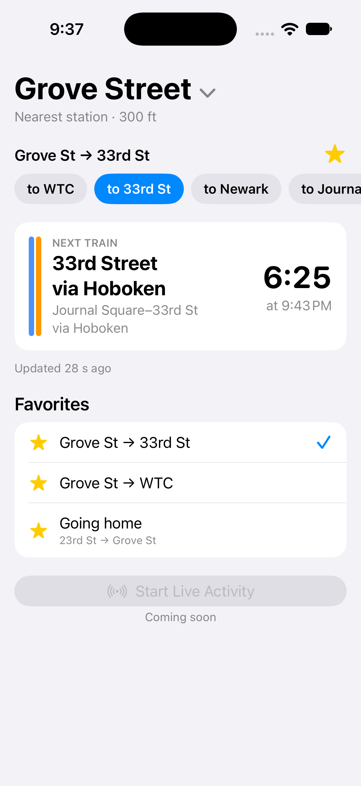
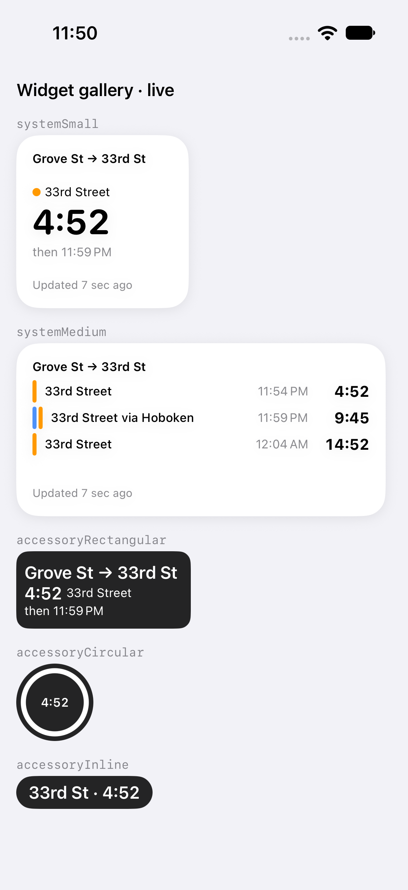
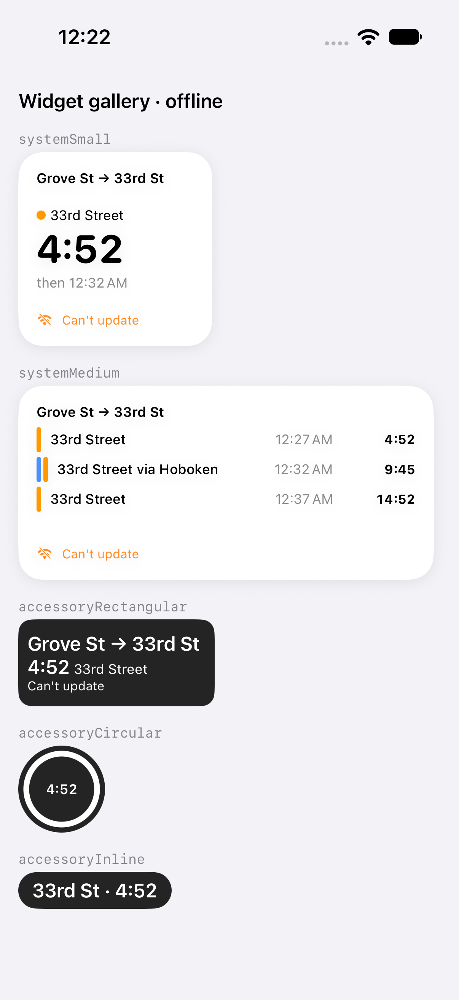
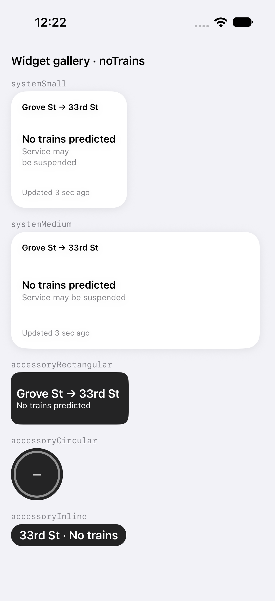
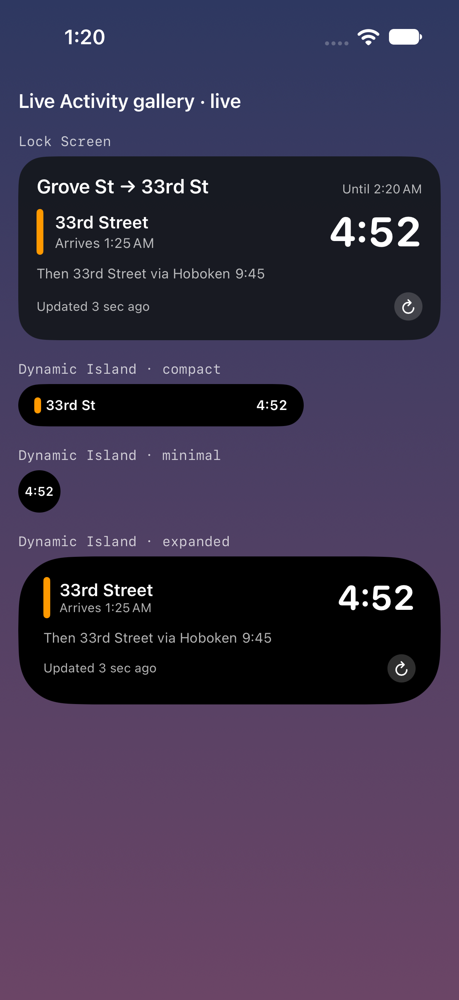
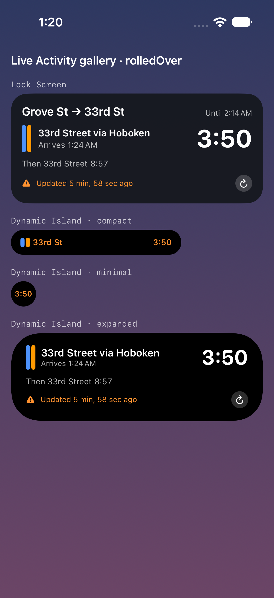
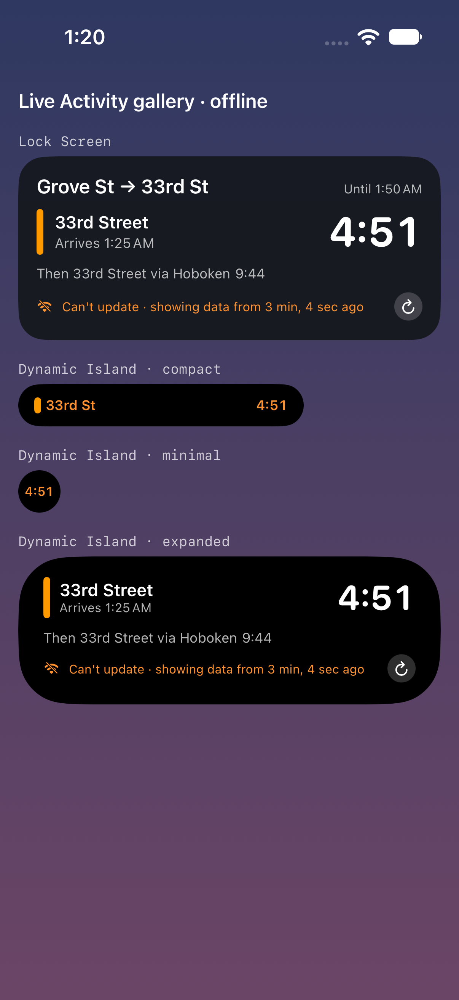
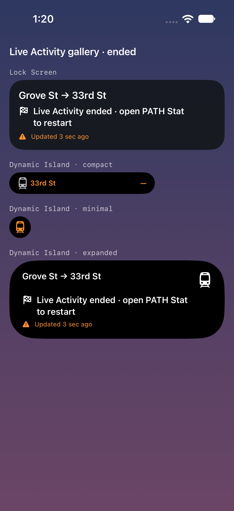

# PATH-stat

[](https://github.com/yesh0907/PATH-stat/actions/workflows/ci.yml)

A native iOS (SwiftUI) app for real-time PATH train arrivals. Phase 1 is the data layer:
`PATHKit`, a pure Foundation + CoreLocation Swift package, plus a macOS debug CLI. Phase 2 is
the main app screen.

## Phase 2: the main screen



- **Station header**: the trip's origin, with "Nearest station · 0.3 mi", "Home station" or
  "Selected station". Tap it to open the station picker (searchable, nearest first with
  distances when location is known, line-colour dots).
- **Destination chips**: the ends of every line through the station (toward NY first),
  plus a "More" menu with the other stops reachable on one line.
- **Next train** card with a live m:ss countdown ("Due" at ≤ 0 s) and the arrival time,
  a smaller **following** card, and up to two **later** trains. Trains come from
  `PATHSnapshot.departures(at:toward:)`, which merges both feed directions and keeps trains
  that stop at the destination.
- **States**: loading, no trains (service may be suspended / late night), can't reach PATH
  (Retry), offline with old data (orange "Can't update — showing data from 3 min ago" banner),
  plus an "Updated 12 s ago" footer and a stale warning.
- **Favorites**: Grove St → 33rd St, Grove St → WTC and Going home (23rd St → Grove St) to
  start with. The star toggles the current trip; long-press a favorite to remove it.
- **Location**: when-in-use only, one-shot `requestLocation()` at 100 m accuracy, no
  background use. If location is denied, a banner offers "Choose station" and "Open Settings".
- Refreshes every 20 s while visible and active, on pull-to-refresh, on trip change and on
  return to foreground. Uses system colours (Dark Mode) and text styles (Dynamic Type); train
  cards, chips and header have VoiceOver labels.

### Smart default trip (`TripPlanner.defaultTrip`)

The app opens on `defaultTrip(location: nil, lastTrip:)`. Each fresh location fix (one-shot, at
launch and on returning to the foreground) and each authorization change re-applies the default,
until you pick something yourself this session:

1. Nearest station is Grove St and within 1 km → **Grove St → 33rd St**.
2. Nearest station is 23rd St and within 1 km → **Going home** (23rd St → Grove St).
3. Any other location → from the nearest station (any distance), to the last trip's
   destination if the last trip started there, else the first terminus (toward NY first).
4. No location → the last trip, else Grove St → 33rd St.

Only manual choices are saved as the last trip. When you change station, the destination
stays if it's still reachable on one line (`TripPlanner.defaultDestination(from:preferring:)`).

### Hooks for later phases

- **Phase 3 (widget)**: done (see below); the widget opens trips through the
  `Trip.url` / `Trip(url:)` deep links (`pathstat://trip?from=GRV&to=33S`).
- **Phase 4 (Live Activities)**: done (see below); the main screen's Live Activity section
  replaced the old placeholder, keeping the `live-activity-button` identifier.

Screenshots: `docs/screenshots/phase2/` (live feed with simulated location: light, dark, and
XXXL type) and `docs/screenshots/phase2/ui-tests/` (one per UI test).

## Phase 3: the widget

| Live | Stale | Offline | Can't reach PATH | No trains |
|---|---|---|---|---|
|  |  |  |  |  |

On the Home Screen: `docs/screenshots/phase3/home-screen-widgets.png`, captured once during development with a one-off SpringBoard automation script that was removed as too flaky. Widget placement on the Lock Screen is not yet visually verified.

- **"Next PATH train"** widget (`PATHStatWidget` extension) in **small** and **medium** on the
  Home Screen, and **rectangular**, **inline** and **circular** on the Lock Screen. Tapping it
  opens the app on that trip (`pathstat://trip?...`).
- **Configuration** (long-press → Edit Widget): *Saved trip* (your favourites, default Grove St
  → 33rd St), *Station & destination* (destinations limited to stations on one line from the
  chosen station), or *Nearest station* (a one-shot location fix when location is allowed for
  the app and widgets; otherwise Grove St → 33rd St with "Location unavailable").
- **Shows** the trip, line colour and headsign, a live m:ss countdown ("Due" on arrival), the
  arrival time, the following train(s) and "Updated … ago".
- **States**: no trains ("No trains predicted · Service may be suspended"), stale data (orange
  "Updated 14 min ago" after 10 min), offline (orange "Can't update" with the cached trains),
  and no data at all ("Can't reach PATH · Tap to open").
- **Refresh**: each timeline is built from one feed snapshot (`WidgetTimeline`), with entries at
  every arrival and departure so trains roll off on time and countdowns tick without reloads.
  iOS decides when to actually reload: the widget asks for the earlier of 15 min and the last
  listed train's departure (never sooner than 5 min); 5 min after a failure; 30 min when no
  trains are predicted. The app saves every fetched snapshot to the shared App Group cache and
  reloads widgets at most once a minute, and again when it goes to the background, so opening
  the app refreshes the widget. Widgets are not real-time: expect data up to ~15 min old.
- **Sharing**: App Group `group.com.yesh0907.PATHStat` holds favourites / last trip
  (`TripStore.shared`, migrated once from the app's old standard defaults) and the latest
  snapshot (`SnapshotCache.shared`). Without the App Group everything still works; the widget
  just fetches for itself and offers the preset trips.
- **Screenshots without a widget host**: launch the app with `-WidgetGallery <state>` (see
  AGENTS.md); `WidgetGalleryUITests` captures one per state.

## Phase 4: Live Activity

| Live | Rolled over | Stale | Offline | Ended |
|---|---|---|---|---|
|  |  |  |  |  |

Live captures: [Lock Screen](docs/screenshots/phase4/lock-screen.png),
[Lock Screen after roll-over](docs/screenshots/phase4/lock-screen-rollover.png),
[ended](docs/screenshots/phase4/lock-screen-ended.png),
[Dynamic Island compact](docs/screenshots/phase4/dynamic-island-compact.png),
[expanded](docs/screenshots/phase4/dynamic-island-expanded.png),
[compact after roll-over](docs/screenshots/phase4/dynamic-island-rollover-compact.png),
[app while live](docs/screenshots/phase4/main-live-activity.png), and
[app after auto-end](docs/screenshots/phase4/main-after-auto-end.png).

- **Shows** (Lock Screen / banner): the trip, the next train's headsign with line colour bars,
  a large live m:ss countdown and its arrival time, "Then …" for the following train,
  "Updated … ago" (orange with a warning icon when the data may be out of date), "Until 9:41"
  (when it ends) and a small Refresh button. Offline: "Can't update · showing data from … ago";
  no trains: "No trains predicted"; ended: "Live Activity ended · open PATH Stat to restart".
  **Dynamic Island**: compact = line colour + destination and the countdown; minimal = the
  countdown (a tram when there is none); expanded = headsign, big countdown, following train,
  freshness and Refresh. Tapping opens the app on the trip (`pathstat://trip?...`).
- **Start it** from the main screen ("Start Live Activity", or "Switch to this trip" when another
  trip is live; "Stop Live Activity" ends it), from a favourite's long-press menu, or with
  Shortcuts / Siri / Spotlight / the Action Button: "PATH Stat home to 33rd" / "Start PATH Stat
  Grove Street to 33rd" (Grove St → 33rd St), "Track my PATH Stat train" / "Start PATH Stat
  Live Activity" (asks for a trip), "Stop PATH Stat Live Activity". One activity at a time:
  starting another replaces it. If Live Activities are off, the app explains and links to Settings.
- **Freshness model** (no push on the free Personal Team):
  - While the app is in the foreground, each 20 s refresh updates the activity (unchanged
    content is skipped).
  - In the background, a **best-effort** `BGAppRefreshTask` (`com.yesh0907.PATHStat.refresh`)
    is requested for the content's stale date after starting and when the app backgrounds; it
    fetches, saves the widget cache, reloads widgets and updates the activity. iOS decides if
    and when it runs; it may not run at all.
  - Without any app code, each update's `staleDate` is the first train's departure (or
    10 min after the fetch, if sooner): the system re-renders then and the views drop the
    departed train and roll over to the next one, with the stale warning.
  - The Refresh button runs `RefreshTrainActivityIntent` in the app's process.
  - Activities end on their own after **60 min** (left on screen for 2 more minutes).
- **Code**: pure logic in PATHKit (`TrainActivityState`, `TrainActivityPlanner`,
  `SnapshotCache.loadOrFetch`); ActivityKit only in `PATHStatWidgetUI/TrainActivities.swift`;
  views in `PATHStatWidgetUI/TrainActivityViews.swift`; the widget extension's
  `TrainLiveActivity`; the app's `LiveActivityController` and `BackgroundRefresh`.
- **Screenshots without ActivityKit**: launch with `-LiveActivityGallery <state>` (see
  AGENTS.md); `LiveActivityGalleryUITests` captures one per state.

### Future: push updates (needs a paid account; not implemented)

Server-pushed updates would make the activity truly live in the background. Documented here
only; nothing below exists in the code:

- Request the activity with `pushType: .token`, observe `pushTokenUpdates`, and send the token
  (with the trip) to a small server.
- The server polls the PATH feed (e.g. every 20–30 s per active trip), runs the same planning as
  `TrainActivityPlanner`, and sends APNs requests with `apns-push-type: liveactivity`, topic
  `com.yesh0907.PATHStat.push-type.liveactivity`, and a payload `aps` with `timestamp`,
  `event: "update"` or `"end"`, `content-state` (the JSON-encoded `TrainActivityState`),
  `stale-date`, and for `end` a `dismissal-date`.
- Push-to-start (iOS 17.2+): `Activity.pushToStartTokenUpdates` lets the server start an
  activity with `event: "start"` plus `attributes-type` / `attributes`.
- `NSSupportsLiveActivitiesFrequentUpdates` raises the update budget; high-priority
  (`apns-priority: 10`) pushes count against a system budget, so most updates should be
  priority 5, with priority 10 reserved for changes riders must see promptly.
- Requires APNs, which a free Personal Team lacks; never use another team for it.

### Hooks for later phases

- Push updates: see above; `TrainActivities` is the single place to add `pushType: .token`.
- `TrainActivityState` is `Codable` and stable, ready to be the APNs `content-state`.

## In-app feedback

Report bugs, design nits, frustrations and ideas straight from the app; each report becomes a
GitHub issue on `yesh0907/PATH-stat`.

- **Open it** by shaking the phone on any screen (including over the station picker and other
  sheets), or with the speech-bubble button next to the station name (or **Send feedback** at the bottom). The gear next to it opens
  feedback settings; "N reports waiting to send" appears there while anything is queued.
- **The sheet** shows a screenshot of the screen as it was just before it opened (Mark up with a
  red pen, Undo, Clear; or Remove / Add screenshot back), a note ("What happened? First line
  becomes the title"), and a category: **Bug** (default), **Design nit**, **Frustration**,
  **Idea**. Send is enabled once there is a note or a screenshot. On success it shows
  "Sent as #42" with a link to the issue; otherwise "Saved — will send later" and why.
- **Context attached to every report** (`FeedbackContext`): app version and build, git commit
  of the build (`PATHStatGitCommit`, `-dirty` for local changes, `unknown` without git), iOS
  version, device model, the screen it was opened on, the trip ("Grove St → 33rd St (GRV →
  33S)"), the station header's context word only (nearest / home station / selected), the
  location permission only (authorized / denied / not determined), when the feed was fetched,
  its age and freshness, the last feed error, the last five notices the app showed (offline
  banner, can't reach PATH, stale data, location off, no trains, Live Activity errors, each
  with a time), the Live Activity state, appearance (light / dark), Dynamic Type size, and a
  timestamp. **No coordinates, distances or other location data are ever sent.**
- **Labels**: exactly `feedback` plus one category label (`bug`, `design-nit`, `frustration`,
  `idea`); the app creates any that are missing.
- **Issue format**: the title is the note's first non-empty line (whitespace collapsed, at most
  80 characters, cut at a word with "…"), or "Bug on main" when there is no note. The body is
  the full note (or `_No note._`), the screenshot (`` or `_No screenshot._`),
  then a collapsed `<details>` "Context" block with a two-column table and the same context as
  sorted-key JSON, and finally a hidden `<!-- pathstat-feedback-id: <UUID> -->`.
- **Screenshots** go to the orphan branch `feedback-assets` (created by the app with just a
  README, so it shares no history with `main` and is never merged) at
  `screenshots/<yyyy-MM-dd UTC>/<report id>.png`, and the issue links
  `https://github.com/yesh0907/PATH-stat/blob/feedback-assets/<path>?raw=true`, which renders
  in the issue for anyone who can read the repo. Issues can't take uploads through the API, so
  a branch is the simplest place that needs no extra service.
- **Never lost**: Send writes the report (and its PNG) to `Application Support/Feedback/pending`
  before any network call. The queue retries on launch, on returning to the foreground, when the
  network comes back, after saving a token, after Background App Refresh, and with Retry now in
  settings. Failures back off 30 s, 1 min, 2 min, … up to 1 h; a network error stops the rest
  of the pass. An uploaded screenshot is remembered, so retries never upload it twice. Reports
  leave the queue only once GitHub has created the issue (the last 20 are listed as sent).
- **Share fallback**: the sheet, the "saved" confirmation and every waiting report have a Share
  button with the formatted text and the screenshot, for when GitHub isn't an option.

### One-time token setup

The app talks to GitHub with a fine-grained personal access token that only you create:

1. GitHub → **Settings** → **Developer settings** → **Personal access tokens** →
   **Fine-grained tokens** → **Generate new token**
   (or <https://github.com/settings/personal-access-tokens/new>).
2. **Resource owner**: `yesh0907`. **Expiration**: e.g. 1 year.
3. **Repository access**: *Only select repositories* → `yesh0907/PATH-stat` only.
4. **Repository permissions**: **Contents: Read and write**, **Issues: Read and write**.
   **Metadata: Read-only** is added automatically. No other permissions.
5. Generate and copy the token. In the app, tap the gear next to **Send feedback**, paste it,
   tap **Save**, then **Test connection**.

Contents write is needed for the screenshot branch, but it can write to any branch, including
`main`. Add a branch ruleset on GitHub (Settings → Rules → Rulesets) that protects `main`
(require pull requests, block force pushes and deletions) so a leaked token can't change it.

The token is stored only in this device's Keychain (`com.yesh0907.PATHStat.feedback`,
this-device-only, never synced), shown only as `github_pat_…` plus its last four characters,
never logged, and never committed to this repository. Remove it from the same screen.

## Data sources

Both endpoints are public, unauthenticated JSON published by the Port Authority (PANYNJ).

### Realtime arrivals

`GET https://www.panynj.gov/bin/portauthority/ridepath.json`

```text
results[]
  consideredStation   station code, e.g. "GRV"
  destinations[]
    label             "ToNY" | "ToNJ"
    messages[]
      target              terminus station code, e.g. "33S"
      secondsToArrival    STRING, e.g. "25"
      arrivalTimeMessage  e.g. "1 min"
      lineColor           hex, or comma list for combined services ("4D92FB,FF9900")
      headSign            e.g. "33rd Street via Hoboken"
      lastUpdated         ISO-8601 with 6-digit fraction + offset, "2026-11-26T20:44:02.212216-05:00"
```

A train's arrival time is `lastUpdated + secondsToArrival`. Lines are identified by colour:

| Line | Colour | Stops (NJ → NY) |
|---|---|---|
| Newark–WTC | `D93A30` | NWK HAR JSQ GRV EXP WTC |
| Hoboken–WTC | `65C100` | HOB NEW EXP WTC |
| Journal Square–33rd St | `FF9900` | JSQ GRV NEW CHR 09S 14S 23S 33S |
| Hoboken–33rd St | `4D92FB` | HOB CHR 09S 14S 23S 33S |
| Journal Square–33rd St via Hoboken | `4D92FB,FF9900` | JSQ GRV NEW HOB CHR 09S 14S 23S 33S |

`toward: X` keeps trains that stop at X later on their line, in their direction. A short-turned
train (its `target` is on its line but before the line's end, e.g. a Newark–WTC train ending at
JSQ) only matches stops up to its `target`.

`arrivalTimeMessage` is usually `"N min"` but can be `"Delayed"` (seen live at NEW ToNY, with a
normal `secondsToArrival`). `TrainArrival` keeps it as-is; the UI should show it rather than
assume a minute count.

### Service alerts

`GET https://www.panynj.gov/bin/portauthority/everbridge/incidents?status=All&department=Path`

```text
status                "Success"
data[]
  incidentMessage
    subject
    preMessage          alert body text
    formVariableItems[] { variableName, val?: [String] }   e.g. "Lines" → ["HOB-WTC","HOB-33"], "Station" → ["HOB"]
  CreatedDate         ms since epoch, as a string
  ModifiedDate        ms since epoch, as a string
```

## Layout

```text
PATHStat.xcodeproj/          iOS app project (hand-written, objectVersion 77) + shared PATHStat scheme
PATHStat/                    SwiftUI app sources (file-system synchronized group)
PATHStatUITests/             XCUITest UI tests driving the app's -UITestScenario / -WidgetGallery modes
PATHStatWidget/              WidgetKit extension: AppIntent configuration, timeline provider, Live Activity
PATHStatWidgetUI/            widget + Live Activity views, attributes, intents, ActivityKit glue (app + extension)
Packages/PATHKit/
  Sources/PATHKit/           library: stations, lines, feed/alerts parsing, PATHClient
  Sources/path-live/         macOS debug CLI
  Tests/PATHKitTests/        Swift Testing suites + Resources/ridepath.json, alerts.json fixtures
```

Main `PATHKit` API: `PATHClient` (fetch and parse), `PATHSnapshot.departures(at:direction:toward:headsign:now:)`
→ `DepartureBoard` (sorted trains, `next`/`following`, `freshness`), `StationCatalog` (stations,
nearest station, lines and direction between stations), `ServiceAlert`, `PATHError`.
Phase 2 adds `Trip` (+ presets, deep links), `StationCatalog.destinationOptions(from:)`,
`PATHSnapshot.departures(at:toward:now:)`, `TripPlanner`, `TripStore`, and `BoardModel` (the
main screen's `@Observable` state: trip selection, location default, single-flight refresh).
Phase 4 adds `TrainActivityState`, `TrainActivityPlanner` and `SnapshotCache.loadOrFetch`.
In-app feedback adds `Feedback/`: `FeedbackReport`, `FeedbackContext`, `RecentNotices`,
`FeedbackIssueFormatter`, `GitHubClient` (`FeedbackIssueService`) and the durable `FeedbackQueue`.
Phase 3 adds `WidgetTimeline`, `WidgetTripResolver`, `SnapshotCache`, `ReloadThrottle`,
`TripStore.shared` and `PATHSnapshot.sampleTrains(now:)` / `sampleNoTrains(now:)`.

## Build, test, run

Requires Xcode 27 / Swift 6.4. No third-party dependencies.

```sh
swift test --package-path Packages/PATHKit                       # unit tests
PATH_LIVE=1 swift test --package-path Packages/PATHKit           # + live feed tests
swift run --package-path Packages/PATHKit path-live [STATION]    # live CLI, default GRV
xcodebuild -list -project PATHStat.xcodeproj
xcodebuild test -project PATHStat.xcodeproj -scheme PATHStat -destination 'platform=iOS Simulator,name=iPhone 17'  # + UI tests
```

UI-test scenarios: launch with `-UITestScenario <loading|trains|noTrains|offline|locationDenied|offlineWithData>`
and optionally `-UITestLocation <lat>,<lon>` and `-UITestFeedback <sent|offline|noToken>` (see AGENTS.md). Coverage includes the
offline-with-data banner and switching trips from a favorite.

Or open `PATHStat.xcodeproj` in Xcode and run the `PATHStat` scheme.

## Signing and roadmap notes

- Signing is Automatic with `DEVELOPMENT_TEAM = 63L4D2UQLD` (the free Personal Team). A free
  personal team is enough for everything in the current scope.
- A paid Apple Developer account becomes useful later for APNs: push-to-start Live Activities
  and server-pushed Live Activity updates (see "Future: push updates"). Live Activities
  themselves (`NSSupportsLiveActivities`) and background app refresh need no capability.
- The widget extension uses the same team. The App Group `group.com.yesh0907.PATHStat` is
  registered only under that team; the app and widget degrade gracefully without it.
- No TestFlight/App Store and no APNs push on a free Personal Team (installed builds expire
  after 7 days); these need the user's own paid individual account.
