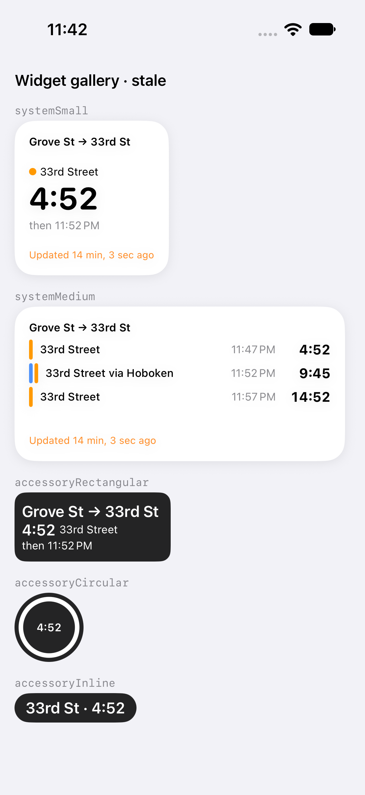

# PATH-stat

[](https://github.com/yesh0907/PATH-stat/actions/workflows/ci.yml)

A native iOS (SwiftUI) app for real-time PATH train arrivals. Phase 1 is the data layer:
`PATHKit`, a pure Foundation + CoreLocation Swift package, plus a macOS debug CLI. Phase 2 is
the main app screen.

## Phase 2: the main screen


- **Station header**: the trip's origin, with "Nearest station · 0.3 mi", "Home station" or
  "Selected station". Tap it to open the station picker (searchable, nearest first with
  distances when location is known, line-colour dots).
- **Destination chips**: the ends of every line through the station (toward NY first),
  plus a "More" menu with the other stops reachable on one line.
- **Next train** card with a live m:ss countdown ("Due" at ≤ 0 s) and the arrival time,
  a smaller **following** card, and up to two **later** trains. Trains come from
  `PATHSnapshot.departures(at:toward:)`, which merges both feed directions and keeps trains
  that stop at the destination.
- **States**: loading, no trains (service may be suspended / late night), can't reach PATH
  (Retry), offline with old data (orange "Can't update — showing data from 3 min ago" banner),
  plus an "Updated 12 s ago" footer and a stale warning.
- **Favorites**: Grove St → 33rd St, Grove St → WTC and Going home (23rd St → Grove St) to
  start with. The star toggles the current trip; long-press a favorite to remove it.
- **Location**: when-in-use only, one-shot `requestLocation()` at 100 m accuracy, no
  background use. If location is denied, a banner offers "Choose station" and "Open Settings".
- Refreshes every 20 s while visible and active, on pull-to-refresh, on trip change and on
  return to foreground. Uses system colours (Dark Mode) and text styles (Dynamic Type); train
  cards, chips and header have VoiceOver labels.

### Smart default trip (`TripPlanner.defaultTrip`)

The app opens on `defaultTrip(location: nil, lastTrip:)`. Each fresh location fix (one-shot, at
launch and on returning to the foreground) and each authorization change re-applies the default,
until you pick something yourself this session:

1. Nearest station is Grove St and within 1 km → **Grove St → 33rd St**.
2. Nearest station is 23rd St and within 1 km → **Going home** (23rd St → Grove St).
3. Any other location → from the nearest station (any distance), to the last trip's
   destination if the last trip started there, else the first terminus (toward NY first).
4. No location → the last trip, else Grove St → 33rd St.

Only manual choices are saved as the last trip. When you change station, the destination
stays if it's still reachable on one line (`TripPlanner.defaultDestination(from:preferring:)`).

### Hooks for later phases

- **Phase 3 (widget)**: done (see below); the widget opens trips through the
  `Trip.url` / `Trip(url:)` deep links (`pathstat://trip?from=GRV&to=33S`).
- **Phase 4 (Live Activities)**: a disabled "Start Live Activity" button ("Coming soon").

Screenshots: `docs/screenshots/phase2/` (live feed with simulated location: light, dark, and
XXXL type) and `docs/screenshots/phase2/ui-tests/` (one per UI test).

## Phase 3: the widget

| Live | Stale | Offline | Can't reach PATH | No trains |
|---|---|---|---|---|
|  |  |  |  |  |

On the Home Screen: `docs/screenshots/phase3/home-screen-widgets.png`, captured once during development with a one-off SpringBoard automation script that was removed as too flaky. Widget placement on the Lock Screen is not yet visually verified.

- **"Next PATH train"** widget (`PATHStatWidget` extension) in **small** and **medium** on the
  Home Screen, and **rectangular**, **inline** and **circular** on the Lock Screen. Tapping it
  opens the app on that trip (`pathstat://trip?...`).
- **Configuration** (long-press → Edit Widget): *Saved trip* (your favourites, default Grove St
  → 33rd St), *Station & destination* (destinations limited to stations on one line from the
  chosen station), or *Nearest station* (a one-shot location fix when location is allowed for
  the app and widgets; otherwise Grove St → 33rd St with "Location unavailable").
- **Shows** the trip, line colour and headsign, a live m:ss countdown ("Due" on arrival), the
  arrival time, the following train(s) and "Updated … ago".
- **States**: no trains ("No trains predicted · Service may be suspended"), stale data (orange
  "Updated 14 min ago" after 10 min), offline (orange "Can't update" with the cached trains),
  and no data at all ("Can't reach PATH · Tap to open").
- **Refresh**: each timeline is built from one feed snapshot (`WidgetTimeline`), with entries at
  every arrival and departure so trains roll off on time and countdowns tick without reloads.
  iOS decides when to actually reload: the widget asks for the earlier of 15 min and the last
  listed train's departure (never sooner than 5 min); 5 min after a failure; 30 min when no
  trains are predicted. The app saves every fetched snapshot to the shared App Group cache and
  reloads widgets at most once a minute, and again when it goes to the background, so opening
  the app refreshes the widget. Widgets are not real-time: expect data up to ~15 min old.
- **Sharing**: App Group `group.com.yesh0907.PATHStat` holds favourites / last trip
  (`TripStore.shared`, migrated once from the app's old standard defaults) and the latest
  snapshot (`SnapshotCache.shared`). Without the App Group everything still works; the widget
  just fetches for itself and offers the preset trips.
- **Screenshots without a widget host**: launch the app with `-WidgetGallery <state>` (see
  AGENTS.md); `WidgetGalleryUITests` captures one per state.

## Data sources

Both endpoints are public, unauthenticated JSON published by the Port Authority (PANYNJ).

### Realtime arrivals

`GET https://www.panynj.gov/bin/portauthority/ridepath.json`

```text
results[]
  consideredStation   station code, e.g. "GRV"
  destinations[]
    label             "ToNY" | "ToNJ"
    messages[]
      target              terminus station code, e.g. "33S"
      secondsToArrival    STRING, e.g. "25"
      arrivalTimeMessage  e.g. "1 min"
      lineColor           hex, or comma list for combined services ("4D92FB,FF9900")
      headSign            e.g. "33rd Street via Hoboken"
      lastUpdated         ISO-8601 with 6-digit fraction + offset, "2026-11-26T20:44:02.212216-05:00"
```

A train's arrival time is `lastUpdated + secondsToArrival`. Lines are identified by colour:

| Line | Colour | Stops (NJ → NY) |
|---|---|---|
| Newark–WTC | `D93A30` | NWK HAR JSQ GRV EXP WTC |
| Hoboken–WTC | `65C100` | HOB NEW EXP WTC |
| Journal Square–33rd St | `FF9900` | JSQ GRV NEW CHR 09S 14S 23S 33S |
| Hoboken–33rd St | `4D92FB` | HOB CHR 09S 14S 23S 33S |
| Journal Square–33rd St via Hoboken | `4D92FB,FF9900` | JSQ GRV NEW HOB CHR 09S 14S 23S 33S |

`toward: X` keeps trains that stop at X later on their line, in their direction. A short-turned
train (its `target` is on its line but before the line's end, e.g. a Newark–WTC train ending at
JSQ) only matches stops up to its `target`.

`arrivalTimeMessage` is usually `"N min"` but can be `"Delayed"` (seen live at NEW ToNY, with a
normal `secondsToArrival`). `TrainArrival` keeps it as-is; the UI should show it rather than
assume a minute count.

### Service alerts

`GET https://www.panynj.gov/bin/portauthority/everbridge/incidents?status=All&department=Path`

```text
status                "Success"
data[]
  incidentMessage
    subject
    preMessage          alert body text
    formVariableItems[] { variableName, val?: [String] }   e.g. "Lines" → ["HOB-WTC","HOB-33"], "Station" → ["HOB"]
  CreatedDate         ms since epoch, as a string
  ModifiedDate        ms since epoch, as a string
```

## Layout

```text
PATHStat.xcodeproj/          iOS app project (hand-written, objectVersion 77) + shared PATHStat scheme
PATHStat/                    SwiftUI app sources (file-system synchronized group)
PATHStatUITests/             XCUITest UI tests driving the app's -UITestScenario / -WidgetGallery modes
PATHStatWidget/              WidgetKit extension: AppIntent configuration, timeline provider
PATHStatWidgetUI/            widget views shared by the app (gallery) and the extension
Packages/PATHKit/
  Sources/PATHKit/           library: stations, lines, feed/alerts parsing, PATHClient
  Sources/path-live/         macOS debug CLI
  Tests/PATHKitTests/        Swift Testing suites + Resources/ridepath.json, alerts.json fixtures
```

Main `PATHKit` API: `PATHClient` (fetch and parse), `PATHSnapshot.departures(at:direction:toward:headsign:now:)`
→ `DepartureBoard` (sorted trains, `next`/`following`, `freshness`), `StationCatalog` (stations,
nearest station, lines and direction between stations), `ServiceAlert`, `PATHError`.
Phase 2 adds `Trip` (+ presets, deep links), `StationCatalog.destinationOptions(from:)`,
`PATHSnapshot.departures(at:toward:now:)`, `TripPlanner`, `TripStore`, and `BoardModel` (the
main screen's `@Observable` state: trip selection, location default, single-flight refresh).
Phase 3 adds `WidgetTimeline`, `WidgetTripResolver`, `SnapshotCache`, `ReloadThrottle`,
`TripStore.shared` and `PATHSnapshot.sampleTrains(now:)` / `sampleNoTrains(now:)`.

## Build, test, run

Requires Xcode 27 / Swift 6.4. No third-party dependencies.

```sh
swift test --package-path Packages/PATHKit                       # unit tests
PATH_LIVE=1 swift test --package-path Packages/PATHKit           # + live feed tests
swift run --package-path Packages/PATHKit path-live [STATION]    # live CLI, default GRV
xcodebuild -list -project PATHStat.xcodeproj
xcodebuild test -project PATHStat.xcodeproj -scheme PATHStat -destination 'platform=iOS Simulator,name=iPhone 17'  # + UI tests
```

UI-test scenarios: launch with `-UITestScenario <loading|trains|noTrains|offline|locationDenied|offlineWithData>`
and optionally `-UITestLocation <lat>,<lon>` (see AGENTS.md). Coverage includes the
offline-with-data banner and switching trips from a favorite.

Or open `PATHStat.xcodeproj` in Xcode and run the `PATHStat` scheme.

## Signing and roadmap notes

- Signing is Automatic with `DEVELOPMENT_TEAM = 63L4D2UQLD` (the free Personal Team). A free
  personal team is enough for everything in the current scope.
- A paid Apple Developer account becomes useful later for APNs: push-to-start Live Activities
  and server-pushed Live Activity updates.
- The widget extension uses the same team. The App Group `group.com.yesh0907.PATHStat` is
  registered only under that team; the app and widget degrade gracefully without it.
- No TestFlight/App Store and no APNs push on a free Personal Team (installed builds expire
  after 7 days); these need the user's own paid individual account.
